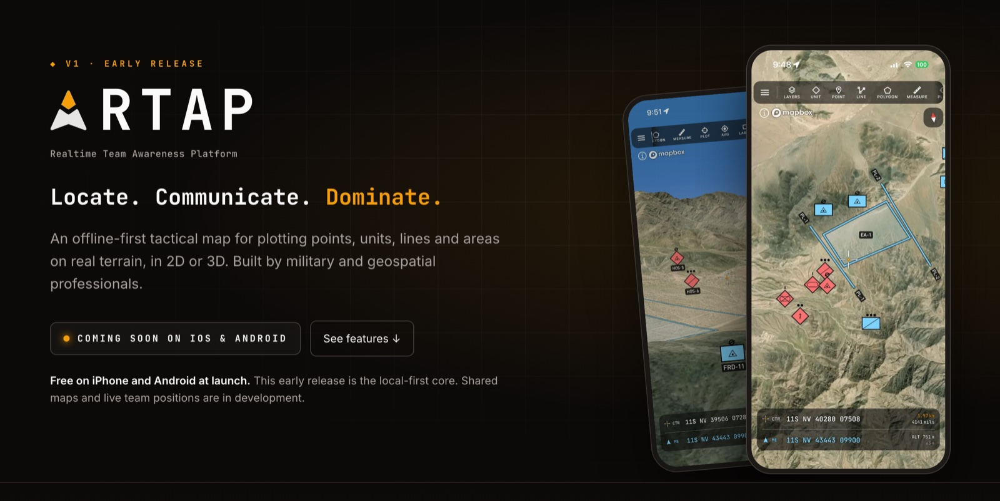

# RTAP website

The marketing site for **RTAP** (Realtime Team Awareness Platform), an offline-first tactical map for plotting
points, units, lines and areas on real terrain, in 2D or 3D. This repo is the website; the mobile app and the API
live in their own repositories.



> **Training and simulation only.** RTAP is not for real-world military use or targeting.

## What's on the site

| Page | What it covers |
| --- | --- |
| **Home** (`/`) | The app tour: seeing the ground in 3D and from an observation post, what you can plot, the MGRS grid, range rings, landscape mode, offline-first storage, who built it, and the roadmap. |
| **Support** (`/support`) | How to get help. |
| **Privacy** (`/privacy`) | The privacy policy. |
| **Terms** (`/terms`) | The terms of use. |

The app hasn't launched yet, so every download button reads "Coming soon on iOS & Android" until the store listings
go live.

## Built with

- [Next.js](https://nextjs.org) 16 (App Router), with every page prerendered as static HTML
- [React](https://react.dev) 19 and TypeScript
- [Tailwind CSS](https://tailwindcss.com) v4, using the same color tokens as the app
- [Vitest](https://vitest.dev) and Testing Library for unit tests, [Playwright](https://playwright.dev) for browser tests
- Hosted on [Vercel](https://vercel.com)

## Getting started

You'll need **Node.js 20.9 or later**.

```bash
npm install
npm run dev
```

Then open [http://localhost:3000](http://localhost:3000). Pages reload as you edit them.

## Scripts

| Command | What it does |
| --- | --- |
| `npm run dev` | Starts the local dev server |
| `npm run build` | Builds for production (every page must stay static) |
| `npm start` | Serves the production build |
| `npm run lint` | Lints with ESLint |
| `npm run typecheck` | Type-checks with TypeScript |
| `npm test` | Runs the unit tests |
| `npm run e2e` | Builds the site and checks every page loads at phone and desktop widths, without sideways scrolling |

Before your first `npm run e2e`, install the browser Playwright uses: `npx playwright install chromium`.

## Project layout

```
src/
├── app/
│   ├── (marketing)/   Pages with the site's nav and footer: home, support, privacy, terms
│   ├── globals.css    Colors, fonts and other design tokens (shared with the app's theme)
│   └── …              Root layout, icons, social preview image, sitemap and robots.txt
├── components/        Nav, footer, phone frames, homepage sections and other UI
├── content/           Feature copy and the screenshot list
├── assets/            Screenshots, fonts and the logo
└── config/site.ts     Site name, tagline, contact email and the site's URL
e2e/                   Playwright browser tests
```

Most wording changes happen in `src/content/` or in a section under `src/components/sections/`.

## Deployment

The site is built for [Vercel](https://vercel.com). Import the GitHub repo into Vercel with the default settings:
pushes to `main` then deploy to production, and every pull request gets its own preview link.

The site's absolute URL, used for links in search results and social previews, comes from `NEXT_PUBLIC_SITE_URL`
when set, and otherwise from Vercel's production domain.

## Contributing

Run `npm run lint`, `npm run typecheck`, `npm test`, `npm run build` and `npm run e2e` before opening a pull request.

The site should look and read like the app, so a few rules apply. Colors match the app's and keep their meaning:
blue for friendly positions, amber for distances. Copy stays honest about what has shipped and what's still coming.
The tone is calm and technical. [`AGENTS.md`](AGENTS.md) has the full list.

---

© Eratas Software LLC
